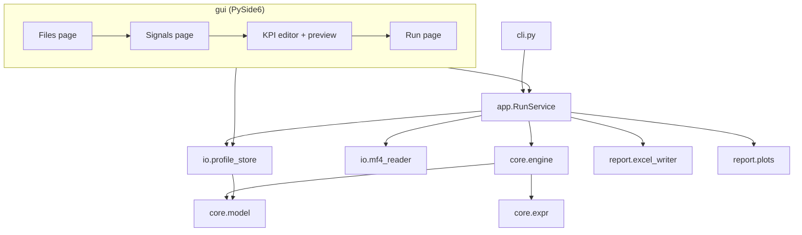

# KPI Studio — architecture for a configurable KPI extractor

Status: design proposal, no implementation yet.
Branch: `claude/project-thread-ki5k8a` (forked from `codex-reconstruct-kpi-pipeline`).

## 1. What we are building

The current tool hard-codes one pipeline per feature (AEB, FCW, LSAEB, LKA): each has its own
segmenter, KPI extractor and visualizer class, and its KPI definitions live in Python plus
`kpi_as_long.xlsx`. Adding a KPI means writing code.

KPI Studio turns that around. The user describes KPIs in a **profile**, a human-readable YAML file,
using a GUI, and a generic engine executes it:

1. **Load** two or more MF4 files.
2. **Pick signals** from the channels found in those files and give them stable names.
3. **Define events, windows and moments**: when something happens, which time window to look at,
   and the exact moment inside it where each KPI is read. Each KPI gets a name; the whole set is
   saved as a profile file.
4. **Run**: extract every KPI for every event occurrence in every file, write an Excel workbook and
   interactive HTML plots.

Non-goals for the first version: replacing the existing feature pipelines (they keep working
side by side), cycle/availability KPIs over whole drives (can be added later as a `reduce` over the
full recording), editing MF4 files.

## 2. Core concepts

| Concept | Meaning | Example |
|---|---|---|
| **Profile** | One YAML file holding everything below. Has a name and a schema version. | `aeb_ncap.kpi.yaml` |
| **Signal** | A stable name mapped to one or more candidate MF4 channel names, with unit and kind. | `egoSpeed` ← `VehSpd`, `ESP_v_Signal` |
| **Derived signal** | A signal computed from others with an expression. | `egoSpeedKph = egoSpeed * 3.6` |
| **Event** | A condition whose rising edge starts an occurrence; optional end condition. | `aebRequest in (1, 2)` |
| **Window** | Time range analysed around each occurrence. | 6 s before start, 3 s after end |
| **Moment** | A named instant inside the window, picked by a rule. | first time `longActAccelFlt < -2` after start |
| **KPI** | A named value read at a moment, between two moments, or reduced over a range. | speed at trigger, brake latency, peak decel |
| **Plot** | A chart of KPI results or of signals around occurrences. | scatter of stop distance vs. trigger speed |

The key idea for "pick the exact moment" is that **moments are first-class and named**. KPIs refer
to moments instead of re-implementing search logic, so one moment (e.g. `brake_onset`) can feed
several KPIs and is drawn as a marker in the verification plots.

## 3. Profile file format

YAML was chosen over JSON/Excel because it allows comments, diffs cleanly in git, and stays readable
when hand-edited. Every profile is validated against a strict schema (unknown keys are errors, so a
typo like `widnow:` is caught immediately instead of silently ignored).

```yaml
schema_version: 1
name: AEB basic
description: Trigger speed, latency and stopping KPIs for AEB activations

timebase:
  rate_hz: 100                  # every file is resampled onto this grid

signals:
  egoSpeed:
    channels: [VehSpd, ESP_v_Signal, egoSpeed]   # first channel found in a file wins
    unit: m/s
    kind: continuous            # continuous -> linear interpolation
  aebRequest:
    channels: [AEB_Req, aebRequest]
    kind: discrete              # discrete -> zero-order hold, never interpolated
    enum: AutoEmergencyBrakingRequestType        # optional, from enum_definitions.yaml
  longActAccel:
    channels: [LongAccel, longActAccel]
    unit: m/s^2
  objDistance:
    channels: [ObjDistX, objDistance]
    unit: m
    required: false             # KPIs using it become "missing_signal" instead of failing the file

derived:
  egoSpeedKph: egoSpeed * 3.6
  longActAccelFlt: lowpass(longActAccel, 10)     # Butterworth, cutoff in Hz

events:
  aeb:
    start: aebRequest in (FULL, PARTIAL)         # enum names or numbers
    end: aebRequest == NONE                      # optional; default = start condition goes false
    min_duration: 0.1                            # s, ignore glitches
    merge_gap: 0.5                               # s, merge occurrences closer than this
    window: { pre: 6.0, post: 3.0 }              # relative to start / end
    moments:
      brake_onset: { first: longActAccelFlt < -2, after: start, within: 1.5 }
      stop:        { first: egoSpeed < 0.1, after: start }
      peak_decel:  { argmin: longActAccelFlt, between: [start, end] }
      ttc_1s:      { crossing: objDistance / max(egoSpeed, 0.1), level: 1.0, direction: falling, before: start }

kpis:
  - name: trigger_speed
    event: aeb
    value: egoSpeedKph
    at: start
    unit: km/h
  - name: brake_latency
    event: aeb
    duration: [start, brake_onset]
    unit: s
  - name: peak_decel
    event: aeb
    value: longActAccelFlt
    at: peak_decel
    unit: m/s^2
  - name: stop_distance
    event: aeb
    value: objDistance
    at: stop
    unit: m
  - name: max_abs_steer_rate
    event: aeb
    reduce: max
    of: abs(derivative(steerWheelAngle))
    between: [start, end]

plots:
  - type: scatter
    title: Stop distance vs trigger speed
    x: trigger_speed
    y: stop_distance
    color_by: file
    reference_lines: [{ y: 0, label: contact }]
  - type: box
    title: Brake latency per file
    y: brake_latency
    group_by: file
  - type: timeseries                # one figure per occurrence, for verification
    event: aeb
    signals: [egoSpeedKph, longActAccelFlt, aebRequest]
    show_window: true
    show_moments: true
```

### 3.1 Moment rules

All rules search inside the occurrence window unless narrowed.

| Rule | Picks | Options |
|---|---|---|
| `start`, `end`, `window_start`, `window_end` | built-in moments of every occurrence | — |
| `first: <cond>` / `last: <cond>` | first/last sample where the condition is true | `after`, `before`, `within` (s), `hold` (must stay true for N s) |
| `argmax: <expr>` / `argmin: <expr>` | time of the extreme value | `between: [m1, m2]` |
| `crossing: <expr>` | time `<expr>` crosses `level` | `direction: rising/falling/any`, `after`, `before`; time is interpolated between samples |
| `offset: <moment>` | another moment shifted by a constant | `by: -0.5` |

If a rule finds nothing, the moment is `None` and every KPI depending on it gets status
`moment_not_found`. Nothing crashes, and the reason is visible in Excel.

### 3.2 KPI forms

| Form | Keys | Result |
|---|---|---|
| Value at a moment | `value`, `at` | expression evaluated at that instant (interpolated or held by signal kind) |
| Duration | `duration: [m1, m2]` | `t(m2) - t(m1)` in seconds |
| Reduction | `reduce` (`max`, `min`, `mean`, `integral`, `time_true`, `count_rising`), `of`, `between` | one number over a range |

Every KPI result row also stores the moment time it was read at, so a reviewer can jump to it.

### 3.3 Expression language

Conditions and values are short expressions such as `aebRequest in (FULL, PARTIAL) and egoSpeed > 5`.
They are parsed with Python's `ast` module against a whitelist and evaluated vectorised on numpy
arrays; **nothing is ever passed to `eval`**. Allowed:

- signal names, numbers, enum member names of the signal being compared
- `+ - * / ** abs`, comparisons, `and or not`, `in (...)`
- functions: `abs, min, max, clip, lowpass(x, hz), derivative(x), integral(x), delay(x, s),`
  `rising(cond), falling(cond), hold(cond, s), between(x, lo, hi)`

Expressions are checked when the profile loads (unknown names, wrong argument counts) and errors
point to the profile key, e.g. `events.aeb.moments.brake_onset: unknown signal 'longAccFlt'`.

## 4. Architecture



Dependency rule: `gui → app → io / report → core`. `core` imports only numpy, pandas and pydantic,
never Qt, asammdf or openpyxl. That keeps the engine fast to unit-test with synthetic arrays and
lets the same run be driven from the GUI, the CLI or a test.

### 4.1 Module layout

```
src/kpi_studio/
  core/
    model.py          # pydantic schema: Profile, SignalDef, EventDef, MomentRule, KpiDef, PlotDef
    expr.py           # safe parser + vectorised evaluator, name/arity checks
    engine.py         # detect_occurrences(), resolve_moments(), compute_kpis()
    results.py        # Occurrence, KpiResult, Status enum, results -> DataFrame
  io/
    mf4_index.py      # scan files: channels, units, rasters, duration (no sample data)
    mf4_reader.py     # read only mapped channels, align onto timebase -> SignalFrame
    profile_store.py  # load/save YAML, schema_version migrations, atomic writes
  report/
    excel_writer.py   # Summary / per-event / Details / Files / RunInfo sheets
    plots.py          # Plotly figures from PlotDef + dashboard index
  app/
    run_service.py    # preflight, per-file jobs, cancellation, progress events
    preflight.py      # signal coverage per file, expression errors, warnings
  gui/
    main_window.py    # 4-step wizard shell
    pages/files_page.py, signals_page.py, kpi_editor_page.py, run_page.py
    widgets/condition_builder.py, moment_editor.py, signal_preview.py
  cli.py              # python -m src.kpi_studio.cli run profile.yaml a.mf4 b.mf4 -o out/
profiles/examples/aeb_basic.kpi.yaml
```

### 4.2 Run data flow

```
files ──► mf4_index (headers only) ──► preflight ──► user confirms
                                                    │
for each file (worker process) ─────────────────────┘
   mf4_reader: read mapped channels → align to 100 Hz grid → SignalFrame
   engine: derived signals → occurrences per event → moments → KPI results
   return list[KpiResult] + FileReport           (no intermediate MF4 chunks on disk)
                    │
merge results ──► excel_writer ──► plots ──► dashboard.html
```

Key data types:

- `SignalFrame`: `time: ndarray`, `values: dict[str, ndarray]`, `units`, `kinds`, `source_channel`
  per signal (for traceability).
- `Occurrence`: file, event, index, `t_start`, `t_end`, `t_window_start`, `t_window_end`.
- `KpiResult`: file, event, occurrence, kpi, value, unit, moment time, `status`, message.
  Results are a long, tidy table; Excel's wide view is a pivot of it.

## 5. GUI

A four-step window that mirrors the workflow, with the profile always editable and savable.

1. **Files**: add/remove MF4 files (drag and drop, multi-select). Shows duration, size and a
   load status per file. Headers are indexed in the background so the window never freezes.
2. **Signals**: a searchable channel tree, merged across files, with a coverage column
   ("found in 3/4 files"). Picking a channel creates a signal; when files name the same thing
   differently the user adds alternatives to `channels`. Derived signals are added with an
   expression field that validates as you type. A small plot previews the signal from any file.
3. **KPI editor**: left list of events and KPIs; right side a form:
   - event start/end built with a condition builder (signal, operator, value rows joined by and/or)
     that writes the expression text, with a raw-text toggle for power users;
   - window pre/post spin boxes;
   - moment editor (rule type dropdown + fields from section 3.1);
   - KPI form (name, form, unit).
   A **Preview** pane runs the current profile on one selected file and draws the signals with the
   window shaded and every moment marked, plus the KPI values. This is how the user confirms the
   moment is the exact one they meant before running a batch.
   **Save / Save as** writes the profile YAML; the KPI and profile names are what the user sees.
4. **Run**: output folder, preflight summary (missing signals per file, warnings), Run and Cancel
   buttons, per-file progress, log panel, and buttons to open the Excel and dashboard when done.

The last files, folder and profile are remembered with `QSettings`, as the current GUI does.

## 6. Outputs

`<output>/<profile>_<timestamp>/`

- `kpi_results.xlsx`
  - `Summary`: one row per occurrence (file, event, #, start time, end time) and one column per KPI,
    header includes the unit; failed cells are empty and highlighted.
  - one sheet per event when the profile has several events.
  - `Details`: the long table, including moment times, status and message for every KPI.
  - `Files`: per file status, duration, which channel each signal was read from, missing signals.
  - `RunInfo`: profile name, profile SHA-256, tool version, run time, input file list, full profile
    text.
- `plots/*.html` plus `dashboard.html` linking all of them.
- `profile.kpi.yaml`: a copy of the exact profile used, so any result can be reproduced.

## 7. Robustness

| Risk | How the design handles it |
|---|---|
| Bad or mistyped profile | Strict pydantic schema, unknown keys rejected, expressions validated at load, errors name the exact key. |
| Different channel names across loggers | Ordered `channels` candidates per signal, exact name first then base name (logic reused from `mf4_extractor._match_channel`). |
| Signal missing in some files | Preflight shows it before the run; optional signals degrade to `missing_signal` per KPI; required ones skip only that file. |
| Different rates, duplicate or non-monotonic timestamps | Every file aligned onto one timebase over the overlapping range; duplicates dropped, sorting enforced; no extrapolation; discrete signals held, never interpolated. |
| One file or KPI fails | Isolation at file, occurrence and KPI level. Each failure becomes a status row; the run continues and the `Files` sheet says what happened. |
| Large files / memory | Only mapped channels are read (`MDF.select`); files are processed one per worker process and released; no MF4 chunk files are written. |
| GUI freezing | Indexing, preview and runs happen off the UI thread; progress is reported through typed Qt signals, and Cancel stops between files. |
| Arbitrary code in profiles | Whitelisted AST evaluator, no `eval`/`exec`. |
| Output corrupted or locked | Profile and Excel written to a temp file then renamed; a locked Excel (open in Excel on Windows) produces a clear message and a retry, not a crash. |
| Results that can't be reproduced | Profile copy, hash, tool version and inputs saved with every run. |
| Profile format evolves | `schema_version` plus migration functions in `profile_store`; old profiles keep loading. |
| Silent wrong numbers | Every KPI stores the moment time; verification time-series plots show window and moments; golden tests on known signals. |

Logging uses the standard `logging` module (file + GUI handler) instead of redirecting stdout as the
current runner does.

## 8. What is reused from `codex-reconstruct-kpi-pipeline`

| Existing code | Use in KPI Studio |
|---|---|
| `src/utils/mf4_extractor.py`: channel matching, suffix cleanup, duplicate-timestamp handling, unit maps and `convert_tact_unit` | Moved into `io/mf4_reader.py` / `io/mf4_index.py` behind a smaller API; the signal-database (Excel) path is dropped. |
| `src/utils/signal_mdf.py`: robust time-vector resolution (`_resolve_time`), `safe_load_mdf` | Reused for files with several masters or missing time channels. |
| `src/utils/signal_filters.py`: `accel_filter` | Becomes the `lowpass()` expression function. |
| `src/utils/enum_loader.py` + `config/enum_definitions.yaml` | Enum names usable in conditions (`aebRequest == FULL`). |
| `src/utils/exporter.py` | Pattern kept, rewritten to write the whole workbook once instead of re-opening it per sheet. |
| `src/viz/visualizers/dashboard_visualizer.py` | Reused as is for `dashboard.html`. |
| `src/viz/plotters/*` and `src/viz/core/*` | Styling and layer ideas (averages, reference lines) carried over; new figures are built directly in Plotly because the current plotters are tied to `graphSpec` sheets and Matplotlib-to-Plotly conversion. |
| `src/gui/main_window.py`, `gui/controllers/pipeline_runner.py` | Stylesheet, `QSettings` persistence and the `QThread` runner pattern; stdout capture replaced by typed progress signals. |
| `src/utils/path_manager.py`, `run_kpi_tool.spec`, `hooks/` | Resource paths and PyInstaller packaging; the spec gains a second entry point. |
| Existing AEB/FCW KPI logic (`utils/event_detector`, `utils/kpis`) | Not called directly; used as the reference to write `profiles/examples/aeb_basic.kpi.yaml` and as a cross-check that the profile reproduces today's numbers. |

Not reused: per-feature pipeline/segmenter/extractor classes, the Excel-based configs
(`kpi_as_long.xlsx`, `graphSpec`), and writing event chunks to disk.

## 9. Testing

- `core` unit tests with synthetic arrays: every moment rule, every KPI form, edge cases (event at
  file start/end, no occurrences, NaNs, missing moment).
- Expression tests: valid and invalid syntax, rejected constructs (`__import__`, attribute access).
- Profile round-trip and migration tests; example profiles validated in CI.
- End-to-end: small MF4 files generated with asammdf in the test fixtures, run through the CLI,
  Excel compared to golden values.
- Parity test: the AEB example profile against current pipeline results on the same recording.
- GUI smoke tests with `pytest-qt` in offscreen mode (load profile, preview, run).

## 10. Implementation plan

1. **Core and CLI**: schema, expression engine, occurrences/moments/KPIs, MF4 reader, Excel
   writer, CLI. Usable headless with a hand-written profile.
2. **Plots and dashboard**.
3. **GUI**: files, signals, KPI editor with preview, run page.
4. **Packaging and parity**: PyInstaller entry point, AEB example profile matched against the
   current tool.

## 11. Open questions

1. Should one run apply a single profile to all files (proposed), or allow different profiles per
   file?
2. Is one row per occurrence the Excel layout you want in `Summary`, or one row per file with
   occurrences as columns?
3. Do you need speed-dependent thresholds (calibration curves like the current `calParam` sheet)
   inside conditions in the first version, or can that wait?
4. Should a KPI defined in one profile be importable into another (a shared KPI library), or is one
   self-contained file per profile enough for now?
